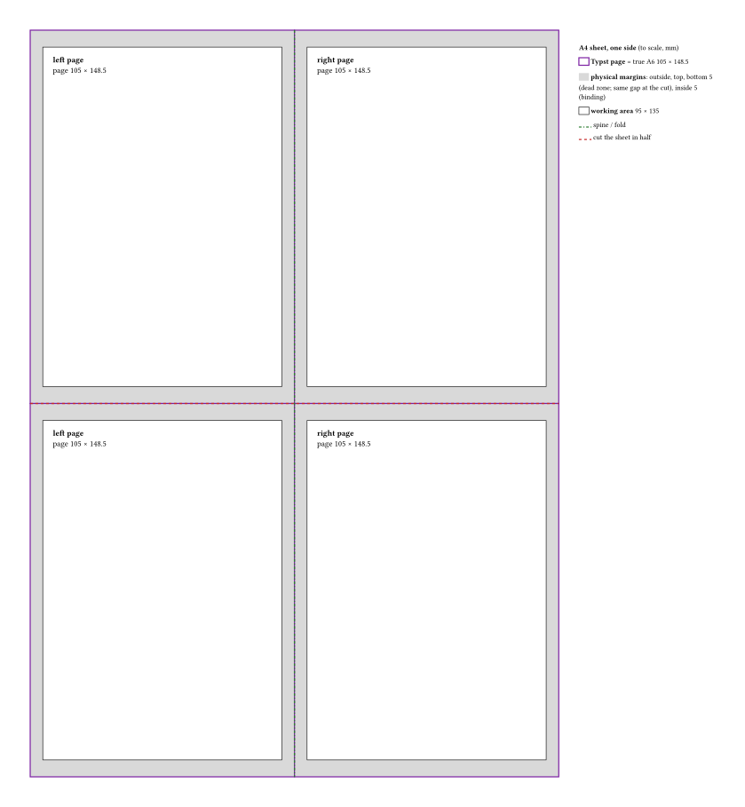
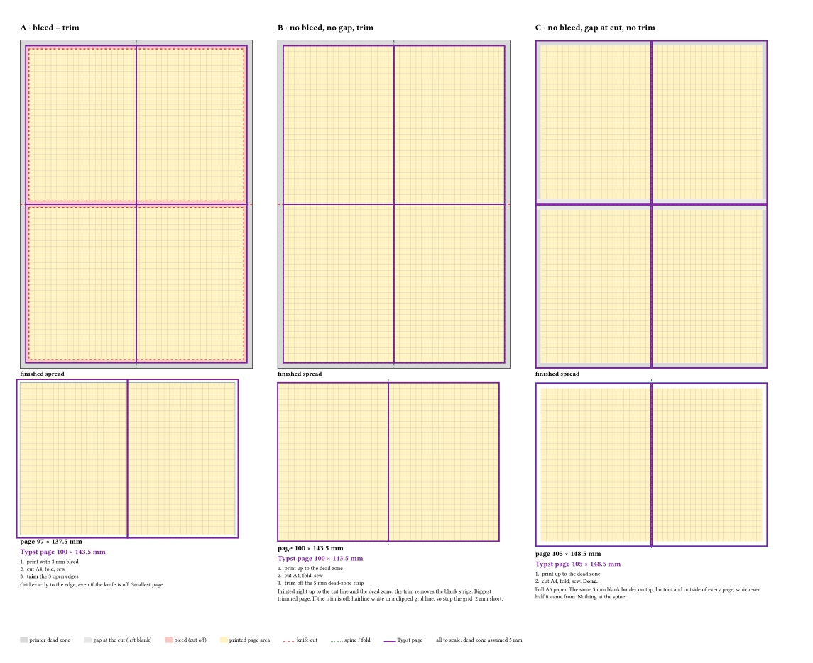

# Printing at home

How the physical side works and how it constrains the design.

Our setup: home duplex printer (black only), A4 paper, cutting knife, sewn binding (likely).
Target: **true A6 booklet (105 × 148.5 mm), 4 pages per A4 side, no bleed**. See [Page model](#page-model-physical-margins).

## Page model: physical margins

**Every physical constraint lives in Typst from the start.** The Typst page is the real page you hold. The printer
and binding limits become **physical margins** declared by the format (`lib/formats.typ`); content never goes there.

| Edge           | Physical margin | Source                                                                           |
|----------------|-----------------|----------------------------------------------------------------------------------|
| outside        | 5 mm            | printer dead zone                                                                |
| top / bottom   | 6.75 mm each    | ≥ 5 mm dead zone on the A4-edge side; **the same gap** left on the cut side, so every page is identical whichever half it came from. Set to give a 135 mm working-area height |
| inside (spine) | 5 mm            | binding: fold curvature, sewing holes                                            |

- Margins are **mirrored**: inside/outside swap between right (odd) and left (even) pages. Typst does this with
  `margin: (inside: …, outside: …)`.
- **Working area: 95 × 135 mm**: everything inside the physical margins. That's where content goes.
- **Design margins** are a per-booklet choice on top of the physical ones.
- **Trimming is optional and independent.** A knife would only cut through physical margins, where there is no
  content, so the design doesn't change.
- **Imposition is trivial**: each Typst page *is* an A4 quarter; pages are placed edge to edge.



The diagram is generated from `lib/formats.typ` by `task docs`, so it always shows the current numbers.
`booklets/format-test-a6-home` shows the same model on real pages, with rulers to measure the printer's dead zone.

### Minimum requirement

The working area must be at least **85 × 135 mm**: that's what's really usable in the Moleskine pocket (90 × 140 mm)
in use today, which loses ~5 mm at the spine and has its grid offset by ~2.5 mm at top and bottom. `a6-home` gives
95 × 135 mm.

### Options considered



- **A: bleed + trim.** The page is printed bigger and trimmed, so content reaches the edge exactly. Rejected: the
  content is tables and grids with inner margins, so there's no need for bleed, and it gives the smallest page.
- **B: no bleed, trim.** The page goes up to the printer limit and the dead-zone strips are trimmed off (100 × 143.5).
  Rejected as the base: the Typst page would not be the paper quarter, and trimming would be mandatory.
- **C: no bleed, gap at the cut, no trim. Chosen.** The Typst page is the true A6, and the printer limits are
  physical margins. Trimming stays optional.

## How to print

```bash
task print -- <booklet>
```

1. This builds `build/<booklet>.pdf` (A6 pages in reading order), then imposes it into
   `build/<booklet>-print.pdf`: A4 sheets, 4 pages per side, in cut-and-stack order.
2. Print **at 100 % / actual size** (never "fit to page"), **duplex, flip on the long edge**, A4.
3. Cut every sheet across the middle (marks at both sides of the cut line, inside the printable area).
4. Put the pile of **top halves on the pile of bottom halves**. For trimmed formats, trim the outer strips now
   (see [Trimmed formats](#trimmed-formats-jottbook-insert)).
5. Fold each half (marks at top and bottom of the fold), nest them in order, check the page numbers, bind.

Page order on small sheet *k* (1 = outermost) of an *N*-page booklet: front `N−2k+2 · 2k−1`, back `2k · N−2k+1`.
The top halves of the A4 sheets carry small sheets 1…A, the bottom halves the rest (A = number of A4 sheets).
If N isn't a multiple of 8, the last bottom half stays empty.

### Trimmed formats: Jottbook insert

A format's page can be narrower than its A4 cell. Imposition (`lib/impose.typ`) then places each page **against the
fold** inside its cell, and the rest of the cell at the outer side is waste. The format names its layout
(`imposition: cut-stack-a4` in `lib/formats.typ`: A4, 2 × 2 cells, cut-stack order, pages against the fold); A6 fills
its cell exactly, so nothing changes for it.

`a6-jott-insert` is an insert for a Leuchtturm1917 Jottbook Pocket A6 (90 × 150, 5 mm rounded corners), hinged at
its spine: **85 × 148.5** (90 − 5 mm hinge room; half of A4 high, so top and bottom are not cut), 20 mm of waste per
page. At the table:

1. Cut in half, stack top halves on bottom halves (as for A6).
2. **Trim both outer strips** at the crop ticks: short lines in the waste, near the top and bottom of each half,
   ending on the trim line. They go away with the waste.
3. **Punch the 4 outer corners** of each half-sheet (5 mm corner punch), one sheet at a time.
4. Fold, nest, sew.

Because the printer's dead zone lands in the waste, the outer margin is only a safety distance from the cut (3 mm).
`booklets/format-test-a6-jott-insert` checks it: trim rulers (1 mm ticks from the trimmed edge), the punch outline,
and a fit checklist.

### Printer calibration

Duplex printers don't place the back side exactly behind the front. Ours printed the back **3 mm higher** than the
front (vertical only; left-right was exact). That comes from the paper path: the back is printed from the other end
of the sheet, so a small registration error shows up doubled.

**Measuring:** `task calibration` builds `build/duplex-calibration.pdf`, one A4 sheet that goes straight to the
printer (no imposition, no printer profile). Print at 100 %, duplex, long edge. Hold it against light: where the
back's lines cross the front's rulers is the offset (vertical rulers: + = back higher). Edge lines on both sides
should be 10 mm from the paper edge (checks centering of each side).

**Fixed in the printer** (Brother DCP-L2532DW, 2026-11-15), so all documents benefit:

1. Ready state: **Menu**, **Start**, then **▲ ×4** → "MAINTENANCE".
2. ▲/▼ to **MAINTENANCE 45**, **OK**.
3. **Y Adjust** → **DX** (duplex second side) → set to **−30**, **OK** ("Accepted"). Only DX was changed.
4. **Stop** to leave.

Units: 1 = 0.084 mm; negative moves the back side down. −36 (the computed 3 mm) overshot by ~0.5 mm; −30 aligned it.
Source: Brother service manual (DCP-7090 family, listed for DCP-L2530DW/L2532DW), maintenance function 45; the
manual describes maintenance mode as meant for service personnel.

**Remaining:** small skew, back side ≈ 0.5 mm lower on the left and ≈ 0.5 mm higher on the right (≈ 0.4°). Not
adjustable in the printer (function 45 only shifts). Comes from paper feed: snug tray guides, fanned paper,
clean pickup roller help. Negligible on an A6 page.

**Software fallback:** the printer profile (`lib/printers.typ`) has a `back-shift` that `task print` applies to back
sides (positive = down). It's `0mm` now that the printer is fixed. If the printer gets reset or replaced, either redo
the printer setting or set `back-shift` there. Another printer gets its own profile: `--input printer=<key>`.

Imposition is plain Typst: each booklet page is exactly one A4 quarter, so pages are placed 1:1 with no scaling.
The booklet template records its page count (`<booklet-pages>`), which `task print` reads with `typst eval`.

## The folded sheet

A sheet folded in half gives 4 pages: 2 on the front, 2 on the back.

```
   FRONT (outside)            BACK (inside)
┌───────────┬───────────┐   ┌───────────┬───────────┐
│  page 4   │  page 1   │   │  page 2   │  page 3   │
│  (back)   │  (cover)  │   │           │           │
└───────────┴───────────┘   └───────────┴───────────┘
              ↑ fold = spine
```

- **Page count is always a multiple of 4.** Each sheet adds exactly 4 pages.
  Short content is padded with blank pages at the end.
- **Sheets nest inside each other.** The outer sheet carries the first and last pages.
  For 8 pages (2 sheets):

  | Sheet     | Front | Back  |
  |-----------|-------|-------|
  | 1 (outer) | 8 · 1 | 2 · 7 |
  | 2 (inner) | 6 · 3 | 4 · 5 |

- Reordering pages onto sheets is **imposition**, done by `task print` (`lib/impose.typ`).
  Design always happens on pages in reading order: 1, 2, 3…

## Paper sizes

| Size | mm          | Relation                 |
|------|-------------|--------------------------|
| A4   | 210 × 297   | our paper                |
| A5   | 148 × 210   | A4 folded/cut in half    |
| A6   | 105 × 148   | A5 folded/cut in half    |

A folded A4 sheet gives an **A5** booklet with no cutting. An **A6** booklet needs a cut.

## A6 from A4

A6 sheets are A5-sized (two A6 pages per side). One A4 side holds two of them, one above the other:

```
A4 side (portrait)
┌───────────┬───────────┐
│  A6 page  │  A6 page  │  ← A5 sheet "top"
├ ─ ─ ─ ─ ─ ┼ ─ ─ ─ ─ ─ ┤  ← CUT (knife), 148.5 mm
│  A6 page  │  A6 page  │  ← A5 sheet "bottom"
└───────────┴───────────┘
            ↑ fold (after cutting)
```

Print duplex → cut A4 in half → fold each half → nest → bind.

What goes into the two halves is a choice:

1. **Two copies.** Both halves get the same sheet, so one print run gives 2 identical booklets.
   This is the simplest imposition: impose the A6 booklet onto A5 sheets, then print each A5 sheet twice on A4.
2. **Cut and stack.** The halves hold different sheets of the same booklet, so it uses half the paper.
   The page order gets more complex, but it's still a tool's job.
3. **A5 paper directly**, if the printer accepts it. Same as an A5 booklet from A4, just one size down.
   Worth checking the printer's supported paper sizes.

(A fourth, classic option is folding A4 twice ("quarto") and cutting the top folds. It has 8 pages per sheet and half
of them print upside down. That's more complex, so it's not pursued for now.)

## Things that affect the design

### Alignment tolerances

Nothing lines up perfectly. The error sources are:

| Error                                                   | Size (rough) | A6 on A4 (cut & stack) | A6 on A5 paper |
|---------------------------------------------------------|--------------|------------------------|----------------|
| Front/back offset of the duplex print                   | 1–2 mm       | yes                    | yes            |
| Hand fold not exactly centred                           | ~1 mm        | yes                    | yes            |
| Knife cut off or crooked → sheets differ in height      | ~1 mm        | **yes**                | no             |

Design rule: **never depend on precise edges.** Avoid thin frames or lines close to the page edge, elements that must
meet exactly across the spine, and tight outer margins (uneven white strips become visible). Generous margins hide
all of these. Trimming the bound booklet's edges fixes cut differences and creep.

### Unprintable border

Home printers can't print to the paper edge: there's roughly 3–5 mm of blank at every sheet edge (to be measured for
our printer). Which page edges that hits depends on where the page sat on the A4 sheet:

- **Spine (fold):** the middle of the sheet, so it is printable and content may cross it.
- **Cut line:** also the middle of the A4 sheet, so it is printable.
- **A4 outer edges:** unprintable.

The chosen model handles this with physical margins of 5 mm on outside, top and bottom of every page. The cut side
doesn't need it, but gets the same gap so all pages are identical.

### Bleed (not used)

Bleed means printing *beyond* the final cut line so a color or image reaches the edge cleanly after trimming. It only
matters for content that must touch a trimmed edge (color fills, photos, edge tabs). Our content (tables, dot and
line grids) always has an inner margin, so we don't use it.

### Inside (spine) margin

A thin sewn booklet opens almost flat; the fold and sewing holes take a few mm. Physical inside margin: **5 mm**
(adjust after the first sewn booklet). On a spread the two inside margins sit side by side, forming a 10 mm gutter.

### Duplex flip direction

Our layout is portrait A4 with upright pages, so the printer must flip on the **long edge** (the usual default). The
wrong setting puts every back side upside down. Check this once with a test print.

### Creep

With many nested sheets, the inner ones stick out at the open edge because of paper thickness. It's negligible up to
about 8–10 sheets (32–40 pages). It can be fixed by trimming after binding.

### Binding

- **Sewing** (likely): a pamphlet stitch through 3 or 5 holes along the fold. It needs a needle, an awl and thread.
  It's well suited to A6.
- **Stapling** needs a long-reach stapler to reach the fold.

## Open questions

- Dead zone: measured ≈ 4 mm left/right, ≈ 2.5 mm bottom (first print, 2026-11-15). Inside our margins, so `dead-zone: 5mm` stays.
- Duplex offset: solved in the printer (maintenance 45, Y Adjust DX = −30); remaining skew ≈ ±0.5 mm.
- Trim or not: optional finishing step, decide after holding a real booklet.
- A6 imposition variant: two copies vs. cut-and-stack (leaning: cut-and-stack).

## Our printer

Brother DCP-L2532DW. The tray accepts A4, Letter, A5, A5 (long edge), A6 and Executive. **Automatic duplex: A4 only.**
Other sizes can be duplexed manually (print the fronts, flip the stack, print the backs). A4 stays the default: it
supports auto duplex and is the easiest paper to buy.
